 

 

## Sobre

Engenheiro de software com foco em backend e experiência em Full Stack. Gosto de construir produtos completos: modelar o banco, desenhar a API, montar a interface e colocar tudo no ar.

Meus projetos pessoais são onde eu pratico o que estudo: arquitetura limpa, testes, autenticação e deploy. Prefiro código legível, testado e fácil de mudar.

## Stack

## Projetos

> Os dois rodam em plano gratuito e hibernam sem uso: o primeiro acesso pode levar cerca de um minuto.

## Formação

- **Ciência da Computação**, bacharelado, Universidade Paulista (2024 a 2027)
- **Formação em Arquitetura de Software** (100 h): Clean Architecture, DDD e Microsserviços
- **Curso de desenvolvimento web**, curso.dev (81 h)
